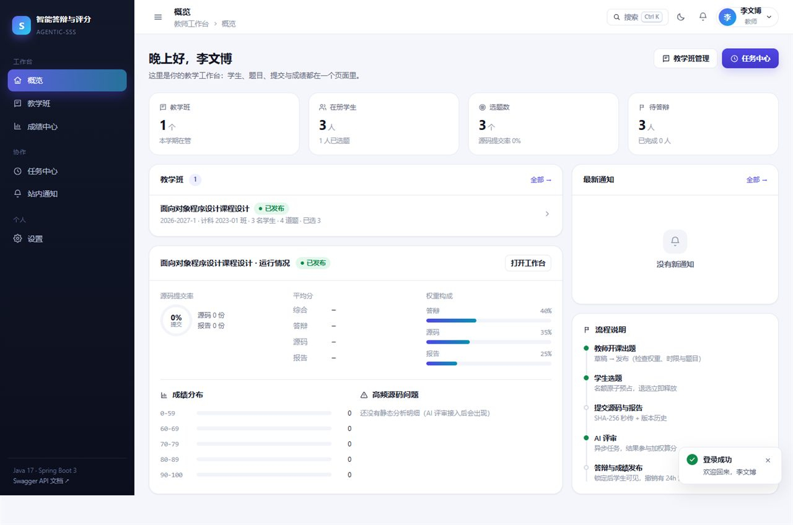
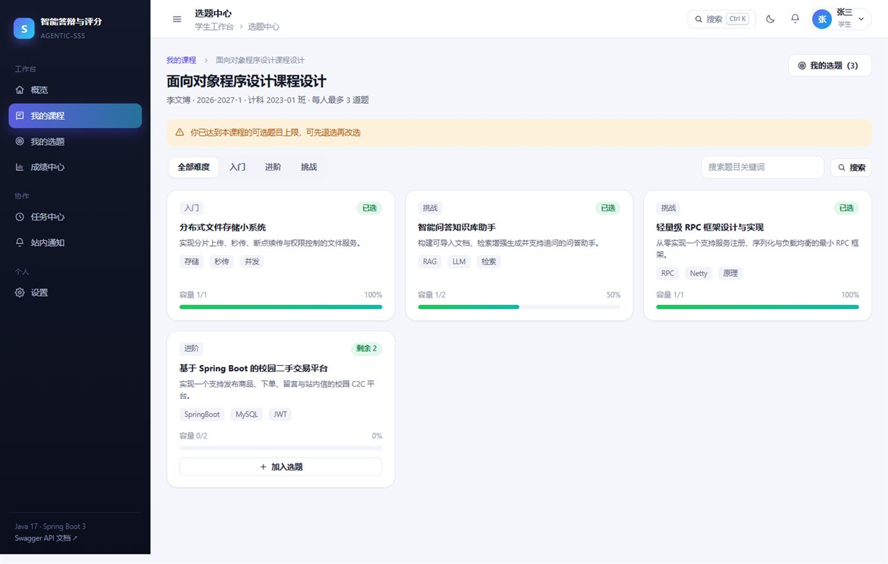
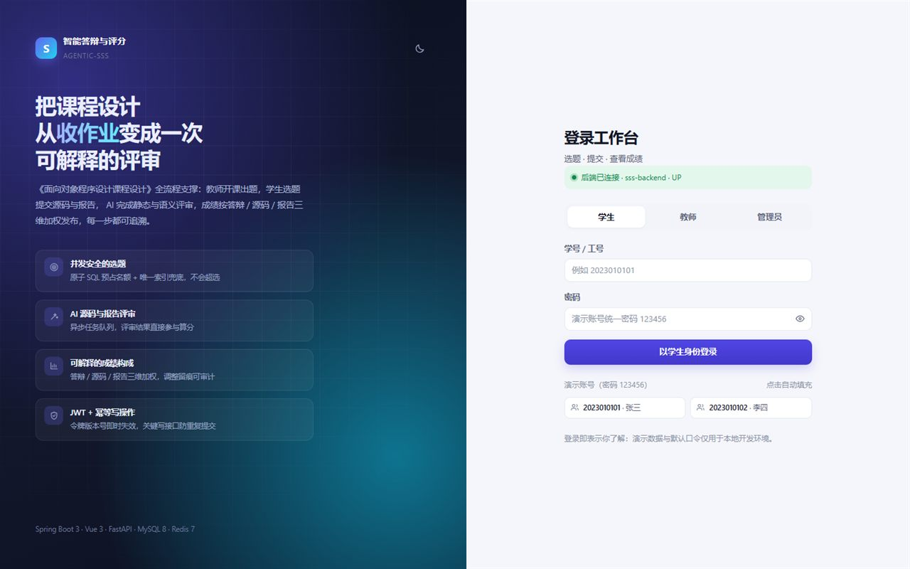
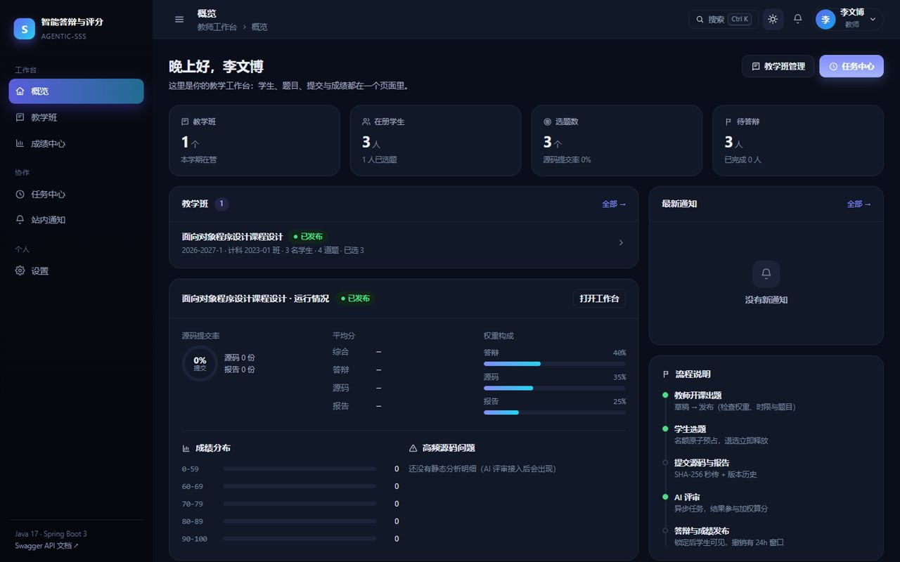

# 课程设计智能答辩与评分系统（agentic-sss）

> 面向《面向对象程序设计课程设计》这类课程的 AI 辅助教学系统，覆盖 **选题 → 提交 → 源码/报告评审 → 语音答辩 → 评分发布** 全流程。

Spring Boot 3 后端（59 个 REST 接口、22 张表、JWT 鉴权）+ Vue 3 工作台前端 + 独立部署的 FastAPI AI 服务。

<!-- 部署到 GitHub 后把 d3412-999/agentic-sss 换成实际地址，并放开下面这行 CI 徽章 -->
[](https://github.com/d3412-999/agentic-sss/actions/workflows/ci.yml)

[](LICENSE)
[](https://openjdk.org/projects/jdk/17/)
[](https://spring.io/projects/spring-boot)
[](https://vuejs.org/)
[](https://vitejs.dev/)
[](https://fastapi.tiangolo.com/)
[](https://www.mysql.com/)
[](https://redis.io/)



<table>
<tr>
<td width="50%"></td>
<td width="50%"></td>
</tr>
</table>

## 目录

- [为什么做这个项目](#为什么做这个项目)
- [功能特性](#功能特性)
- [界面](#界面)
- [技术栈](#技术栈)
- [架构](#架构)
- [目录结构](#目录结构)
- [快速开始](#快速开始)
- [配置](#配置)
- [本地状态持久化](#本地状态持久化)
- [API](#api)
- [用 IDEA 运行](#用-idea-运行)
- [开发约定](#开发约定)
- [测试与 CI](#测试与-ci)
- [文档](#文档)
- [常见问题](#常见问题)
- [已知限制](#已知限制)
- [路线图](#路线图)
- [贡献](#贡献)
- [许可证](#许可证)

## 为什么做这个项目

课程设计的痛点在“过程”而不是“结果”：出题靠 Excel、选题靠抢、材料散落在群文件里、答辩时凭印象给分，
最后成绩构成说不清楚。这个项目把整条流程收进一个系统：教师配置开课 → 学生选题并提交材料 →
系统异步做源码/报告评审 → 教师核对分数并发布，每一步都有状态、留痕与可解释的算分依据。

它同时是一个**全栈工程实践样本**：真实的分层后端（Controller / Service / Mapper + Flyway 迁移）、
无 UI 框架的前端设计系统、独立部署的 AI 服务，以及可复现的本地环境（Docker Compose）与 CI。

## 功能特性

| 模块 | 能力 | 状态 |
|---|---|---|
| 认证 | 登录 / 刷新 / 登出 / 改密 / 当前用户，BCrypt + 无状态 JWT + 令牌版本号即时失效 | ✅ |
| 教学组织 | 课程模板、开课生命周期（草稿→发布→关闭→归档）、学生名单、教学仪表盘 | ✅ |
| 题目与选题 | 出题、批量发布/归档、学生浏览；选题用「原子 SQL 预占 + 唯一索引」防超选 | ✅ |
| 提交与文件 | 源码 zip / 报告上传（SHA-256 秒传、Zip Slip 检查）、版本历史、异步解析 | ✅ |
| AI 评审 | 异步调用 AI 服务做源码与报告评审，结果落库并参与算分；PDFBox / POI 抽取报告正文 | ✅ 已实现（真实评审需配置 LLM_API_KEY） |
| 优秀作品模板库 | 教师挑选优秀报告加入 AI 模板库（LightRAG 优先，本地兜底），供后续报告评审 RAG 参考 | ✅ |
| 成绩 | 三维加权算分、人工调整（原因入审计）、发布/撤销、异步导出 CSV、学生查询 | ✅ |
| 通知与任务 | 站内通知、跨页面任务中心（进度轮询、取消、结果查看） | ✅ |
| 前端工作台 | 12 个页面、深色主题、命令面板（Ctrl K）、响应式布局、骨架屏与空态 | ✅ |
| 语音答辩 | 教师发起答辩（AI 出题）→ 学生逐题录音 → ASR 转写 → AI 评分 → 成绩；摄像头「在场检测」（只判画面里有没有人） + **整场答辩录像（画面+声音）留存、教师回放/下载** | ✅ 主链路已实现（实时流式代理、人脸身份识别为下一阶段） |
| 答辩监考 | 答辩中**只读查看本人源码**（服务端解压、只回纯文本、无下载入口）；切屏 / 开发者工具 / 粘贴等**弱信号上报**，累计达阈值暂停答辩，由教师恢复或确认终止 | ✅ 已实现（前端检测只是提高作弊成本，不是判据） |
| 静态分析 | Checkstyle / PMD / SpotBugs 调度与问题明细落库 | 🚧 未实现 |

## 界面

| 页面 | 角色 | 说明 |
|---|---|---|
| 概览 `/` | 全员 | 角色化 KPI、教学班进度、材料流水线、通知与流程说明 |
| 教学班 `/offerings` | 教师 | 状态筛选、新建开课抽屉、课程模板、发布阻塞项逐条提示 |
| 开课工作台 `/offerings/:id` | 教师 | 概览 / 题目 / 学生 / 成绩 / 优秀作品 / 答辩 / 设置 七个页签 |
| 我的课程 `/courses` | 学生 | 课程卡片、选题窗口、限额与不可选原因（后端枚举码已翻译成中文） |
| 选题中心 `/courses/:id/topics` | 学生 | 卡片化题目、多选、名额可视化、详情抽屉 |
| 我的选题 `/selections` | 学生 | 五步材料流水线、拖拽上传（带进度）、版本历史、重新评审、退选、进入答辩 |
| 答辩 `/defense/:sessionId` | 教师/学生 | 逐题录音作答（WAV 上传 → ASR 转写）、摄像头在场检测、**右下角录像小窗 + 整场录像上传**、结束答辩、教师 AI 评分与录像回放 |
| 成绩中心 `/grades` | 教师/学生 | 教师：摘要+表格+调整/发布/导出；学生：分项与综合分构成 |
| 任务中心 `/tasks` | 全员 | 本机发起的异步任务、进度、取消、结果 JSON |
| 通知 / 设置 | 全员 | 未读筛选与已读、改密、主题切换、会话安全 |

界面细节：

- **设计系统**：CSS 变量驱动的浅色/深色双主题（跟随系统偏好并本地记忆），品牌靛蓝 + 青色强调；
- **交互**：破坏性操作走确认弹窗，异步结果用 Toast（附带 `traceId` 便于排查），列表有骨架屏与「下一步」空态；
- **快捷入口**：`Ctrl / Cmd + K` 打开命令面板，可跳转任意有权限的页面、切换主题、打开 Swagger；
- **响应式**：≥1180px 四列 KPI；≤900px 侧边栏折叠为抽屉、隐藏面包屑；420px 可用。

<p align="center">
  
</p>

## 技术栈

| 层 | 技术 |
|---|---|
| 前端 | Vue 3.5 + Vite 6 + Vue Router 4（原生 `fetch` 封装，无 UI 框架、无图标库） |
| 后端 | Spring Boot 3.3.5、Java 17、MyBatis-Plus 3.5.7、Flyway 10.22 |
| 安全 | Spring Security 6 + JJWT 0.12，`Authorization: Bearer <token>` |
| 存储 | MySQL 8（Flyway 自动建表）、Redis 7（限流 / 幂等 / 令牌）、本地磁盘（`./data/objects`） |
| AI 服务 | Python 3.12+、FastAPI、LangChain（OpenAI 兼容）+ LightRAG（可选） |
| 构建 | Gradle 9 + Wrapper（`./gradlew build`）+ GitHub Actions |

## 架构

```
浏览器 (Vue 3 :3002)
   │  REST + Bearer JWT   { code, message, data, traceId }
   ▼
Spring Boot :8084  ── Controller → Service → Mapper
   │        │              │
   │JDBC    │Redis         │HTTP + X-Internal-Token
   ▼        ▼              ▼
MySQL:3306  Redis:6379   FastAPI :8000（AI 能力，不对外暴露）
   │
   └── 本地磁盘 ./data/objects（FileStorageService）
```

## 目录结构

```
agentic-sss/
├── .github/
│   ├── workflows/ci.yml           # 三模块并行 CI
│   ├── ISSUE_TEMPLATE/            # Bug / 功能建议表单
│   ├── PULL_REQUEST_TEMPLATE.md
│   └── dependabot.yml             # 依赖自动升级
├── docker-compose.yml             # 本地 MySQL + Redis
├── .env.example                   # 环境变量样例
├── .editorconfig / .gitattributes # 编辑器与换行约定
├── docs/
│   ├── 需求文档.md                 # 角色/状态机/功能需求/创新点/验收清单
│   └── screenshots/               # README 用截图
├── scripts/
│   ├── init-local-db.sql          # 用本机 MySQL 时建库建账号
│   └── start-redis.ps1            # Windows 下启动本机 Redis
├── backend/                       # 后端（Gradle 工程）
│   ├── build.gradle / settings.gradle / gradle.properties
│   ├── gradlew / gradlew.bat / gradle/wrapper/
│   ├── tools/gen_entities.py      # 从 DDL 反向生成 entity / mapper
│   └── src/main/
│       ├── java/org/spring_web/spring_boot_service/
│       │   ├── controller/ service/ mapper/ entity/ dto/
│       │   ├── config/ security/ common/ client/
│       │   └── SpringBootServiceApplication.java
│       └── resources/{application.yaml, db/migration/}
├── langchain_service/             # AI 服务（FastAPI）
│   ├── main.py
│   └── app/{core,api,schemas,prompts,services,rag,utils}/
├── vue/                           # 前端
│   ├── vite.config.js
│   └── src/
│       ├── components/            # Icon / AppLayout / Modal / Drawer / Pager ...
│       │   └── offering/          # 工作台五个页签
│       ├── views/                 # 12 个页面
│       ├── stores/                # session / theme / toast / confirm / tasks
│       ├── api/                   # http 封装 + 59 个接口映射
│       └── styles/main.css        # 设计系统
├── CONTRIBUTING.md / SECURITY.md / CODE_OF_CONDUCT.md
├── CHANGELOG.md
└── LICENSE
```

## 快速开始

### 1. 环境要求

| 工具 | 版本 |
|---|---|
| JDK | 17 |
| Gradle | 随仓库自带 Wrapper（9.0.0，无需本机安装） |
| Node.js / npm | 18+（推荐 20）/ 9+ |
| Python | 3.12+（仅 AI 服务需要） |
| MySQL | 8.0+ |
| Redis | 7.x（**必需**，登录与幂等依赖它） |

### 2. 启动基础设施

```bash
cp .env.example .env
docker compose up -d          # MySQL + Redis
docker compose ps             # 等两个服务变成 healthy
```

若用本机已装的 MySQL / Redis：

```bash
mysql -h 127.0.0.1 -u root -p < scripts/init-local-db.sql   # 建 sss 库与应用账号
powershell -ExecutionPolicy Bypass -File scripts\start-redis.ps1
```

### 3. 一键启动前后端（推荐）

```cmd
dev.cmd up
```

一条命令完成：读配置 → 检测端口占用 → 清理本项目残留进程 → 启动后端 → 等健康检查 → 启动前端 → 验证 `/api` 代理链路。

| 命令 | 作用 |
|---|---|
| `dev.cmd up` | 启动（端口被占会自动清理；已在运行则直接提示，不重复启动） |
| `dev.cmd down` | 停止（按监听者精确结束，端口一定释放） |
| `dev.cmd restart` | 先停再起 |
| `dev.cmd status` | 查看端口、PID、健康检查、日志路径 |
| `dev.cmd logs` | 打开日志目录 |

可选参数：`-Force`（端口被无法确认归属的进程占用时强制清理）、`-BackendOnly`、`-FrontendOnly`。

端口**不在脚本里硬编码**：后端读 `application.yaml` 的 `${SERVER_PORT:默认值}`，前端读 `vue/.env` 的 `FRONTEND_PORT`。
启动前脚本会校验 `VITE_API_TARGET` 与后端端口是否一致，不一致直接报错，不让错配跑到浏览器里。

> 如果只想按端口查问题，`powershell -ExecutionPolicy Bypass -File scripts\port-doctor.ps1` 会输出「声明端口 / 实际监听 / 代理目标 / 端到端探测」四段事实。

### 4. 手动启动后端（:8084）

```bash
cd backend
./gradlew bootRun             # Windows: gradlew.bat bootRun
```

首次启动 Flyway 自动建 22 张表并写入演示数据。

| 地址 | 说明 |
|---|---|
| http://127.0.0.1:8084/api/v1/health | 健康检查（免鉴权） |
| http://127.0.0.1:8084/swagger-ui.html | Swagger UI（Authorize 填 accessToken） |
| http://127.0.0.1:8084/actuator/health | Actuator |

### 5. 手动启动前端（端口见 `vue/.env` 的 `FRONTEND_PORT`）

```bash
cd vue
cp .env.example .env
npm install
npm run dev
```

### 6. 启动 AI 服务（:8000，可选）

```bash
cd langchain_service
python -m venv .venv
.venv\Scripts\activate            # Linux / macOS: source .venv/bin/activate
pip install -r requirements.txt
cp .env.example .env
python main.py
```

不启动 AI 服务也能跑通主链路，涉及 AI 的能力会降级为 `50301 AI_UNAVAILABLE`。

没有大模型 Key 时，可以在 langchain_service/.env 里把 LLM_PROVIDER 改为 mock，AI 接口会返回结构完整的示例数据，便于前后端联调。

**语音转写 / 在场检测（可选，答辩需要）**：默认 `ASR_PROVIDER=mock`、`FACE_PROVIDER=mock`，不装模型也能联调整条答辩链路。要切换成真实能力：

```bash
cd langchain_service
pip install -r requirements-optional.txt   # sherpa-onnx + opencv-python-headless
# 下载中文流式/离线模型到 ./models/ 并把 ASR_MODEL_DIR 指过去（含 tokens.txt 与 *.onnx）
# .env: ASR_PROVIDER=sherpa_onnx  FACE_PROVIDER=opencv
```

模型与接口细节见 [docs/defense-asr-face.md](docs/defense-asr-face.md)。

### 6. 演示账号

**seed 账号**（`V2__seed_demo_data.sql` 写入，仅用于本地演示）密码统一为 `123456`。

| 账号 | 姓名 | 角色 |
|---|---|---|
| `2023010101` / `2023010102` / `2023010103` | 张三 / 李四 / 王五 | 学生 |
| `T2019008` / `T2019009` | 李文博 / 周敏 | 教师 |
| `admin` | 系统管理员 | 管理员 |

**教师在教学班里新建/导入的学生**，初始密码默认就是**学号**本身
（`sss.student.default-password-mode=STUDENT_NO`），首次登录强制改密；
教师端「重置密码」也会重置回学号。想改回所有新账号统一密码，把该配置设为 `FIXED`
并把 `sss.student.default-password` 设成你要的值。

## 配置

所有配置项都带默认值，改一处需同步相关位置：

| 配置 | 默认值 | 位置 |
|---|---|---|
| 后端端口 | `8084` | `application.yaml` `server.port`（唯一真相源）↔ `vue/.env` `VITE_API_TARGET` |
| 前端端口 | `5173` | Vite dev server ↔ `sss.cors.allowed-origins` |
| AI 服务端口 | `8000` | `langchain_service/.env` `AI_PORT` ↔ `sss.ai.base-url` |
| 数据库 | `sss` / `sss` / `sss123456` | `.env` ↔ `application.yaml` ↔ `docker-compose.yml` |
| Redis 口令 | `123456` | `.env` `REDIS_PASSWORD` ↔ `application.yaml` |
| 内部令牌 | `change-me` | `application.yaml` `sss.ai.internal-token` ↔ `langchain_service/.env` |
| JWT 密钥 | `change-me-...` | `application.yaml`（≥ 32 字节） |
| ASR 提供方 | `mock` | `langchain_service/.env` `ASR_PROVIDER`（`mock` / `sherpa_onnx`） |
| 人脸在场提供方 | `mock` | `langchain_service/.env` `FACE_PROVIDER`（`mock` / `opencv`） |

完整环境变量清单见 `.env.example`。Spring Boot 不读取 `.env` 文件，它读取同名环境变量；不设置时使用 `application.yaml` 里的默认值。

> 后端默认 8084（`application.yaml` 的 `${SERVER_PORT:8084}`），前端 dev server 默认 3002（`vue/.env` 的 `FRONTEND_PORT`）。改端口时两处一起改，`dev.cmd up` 会在启动前校验代理目标是否对得上。

### 评审与答辩规则（V13 起可配）

| 配置 | 默认值 | 作用 |
|---|---|---|
| `sss.ai.review.stale-minutes` | `15` | 评审任务超过该时长仍停在 PENDING/RUNNING 就由看门狗收敛为 FAILED |
| `sss.ai.review.watchdog-interval-seconds` | `120` | 看门狗扫描间隔 |
| `sss.defense.question-rule.base-count` / `max-count` | `6` / `10` | 基础题数 / 计分题上限（加分题不占上限） |
| `sss.defense.question-rule.tiers` | T0~T4 | 源码分档 → 题数增量（`0-59→6`、`60-74→7`、`75-84→8`、`85-94→9`、`95-100→10`） |
| `sss.defense.question-rule.base-mix` / `high-tier-mix` | `40,40,20` / `30,40,30` | 难度配比（T3 起换高分配比），最大余数法保证求和等于题数 |
| `sss.defense.principle.threshold` | `60` | 维度平均分通过线 |
| `sss.defense.principle.fail-count-for-ai-dependent` | `2` | 几项不通过判为「完全依赖 AI」 |
| `sss.defense.batch.max-students` / `concurrency` | `50` / `2` | 单批人数上限 / 并发路数（钳制 1~3） |
| `sss.defense.batch.allow-when-grade-published` | `false` | 成绩已发布后是否允许再发起答辩 |

前端不硬编码这些值：进「答辩」页先调 `GET /teacher/defense/question-rule`，档位表、题数预览、阈值、批量上限都来自这一个接口，保证预览与落地结果一致。

> **启动后端时注意**：若 shell 里存在 `SERVER__PORT` 之类的变量，Spring 宽松绑定会把它当成 `server.port` 覆盖掉 8084（表现为 `Port xxxxx was already in use`）。用 `env -u SERVER__PORT ./gradlew bootRun` 或显式 `--args='--server.port=8084'`。


## 本地状态持久化

刷新、关浏览器、两个标签页同时开——这些场景下「刚才传到哪了 / 刚才填到哪了」不该丢。
前端所有本地状态收敛在 `vue/src/utils/storage.js` 一层，调用方只写 `get/set`。

### 存储层做了什么

每条记录是一个信封 `{v, t, e, h, d}`：`v` schema 版本、`t` 写入时间、`e` 过期时间、`h` 内容校验哈希、`d` 序列化后的数据。

- **可校验**：版本不兼容、哈希对不上、已过期的数据在读取时直接丢弃并删除，不会把坏数据带进页面；
- **可清理**：`list()` / `stats()` 给出条目、大小、模块，设置页有「本地缓存」面板可逐条删或一键清空；
- **不串味**：key 强制为 `sss:{module}:{userId}:{context}`，换账号看不到上一个人的草稿；
- **可降级**：隐私模式、`QuotaExceededError`、读不到 storage 时自动转内存态，业务代码不写 `if`，UI 会提示「当前浏览器无法保存本地数据（不影响本次上传）」；
- **可换介质**：API 全是 `async`，默认驱动是 localStorage；将来换 IndexedDB 只需 `storage.useDriver()`，调用方不动。

### 各类数据存在哪

| 场景 | 模块 / 介质 | 保存时机 | 恢复校验 | TTL |
|---|---|---|---|---|
| 已上传成功的文件（有 `fileId`） | `upload` / localStorage | 上传成功、拖拽排序、移除后 200ms 内 | 逐条查 `GET /api/v1/files/{id}`，`exists=false` 就从列表剔除并提示 | 24h |
| 上传队列（待传/失败/中断） | `upload` / sessionStorage | 同上（200ms 节流） | 只保留 `name+size+lastModified` 票据，刷新后标「需重新选择」，重选同名同大小文件自动接回队列 | 会话 |
| 多标签页占用 | `upload` / localStorage | 有文件时每 5s 心跳 | 15s 不刷新即视为过期 | 15s |
| 新建教学班表单 | `draft` / localStorage | 字段变化防抖 400ms | 打开弹窗时询问「恢复未完成的教学班？」 | 7d |
| 新建/编辑题目 | `draft` / localStorage | 同上 | 按题目 id 分别保存，互不覆盖 | 7d |
| 批量导入学生（含步骤与解析结果） | `steps` / localStorage | 同上 | 恢复后跳回预览步，并提示「名单可能已变化，建议重新解析」 | 7d |
| 后台任务（重算/导出/复评） | `async` / localStorage | 状态每变一次 | 刷新后按 taskId 重新查询后端，不伪造进度 | 7d |

介质选择的理由：能跨「关浏览器」才有意义的放 localStorage；只对当前标签页有意义的放 sessionStorage（刷新仍在、关页即清）。

### 恢复的三个入口

1. **路由守卫**（`persist/resume.js` + `router.afterEach`）：全局性的恢复——清理过期数据（5 分钟节流一次）、把没跑完的异步任务重新挂上轮询。放这里是为了「从任意页面进来都能续上」，不用每个页面都写一遍。
2. **组件挂载**：需要组件内部状态的恢复（上传队列、表单草稿）必须由组件自己做，守卫里拿不到 ref；统一走 `useDraft` / `createUploadStore`。
3. **多标签页**：`storage` 事件 + 心跳。后打开的标签页看到别人在操作就转只读并禁用上传区，持有者关页后 15s 内自动解除。

### 清理入口

设置页 →「本地缓存」：列出每条记录的模块、上下文、大小、更新时间，可单条删除 / 清理过期 / 全部清空。
只清 `sss:{module}:{userId}:{context}` 规范下的数据，**不会**清除登录令牌（`sss.accessToken`）与主题偏好（`sss.theme`），所以清完不用重新登录。

### 单元测试

```bash
cd vue && npm test        # node --test，30 个用例，零额外依赖
```

覆盖：正常读写、命名空间隔离、schema 版本升级丢弃、TTL 过期、哈希篡改丢弃、`QuotaExceeded` 降级、隐私模式、跨标签页 `storage` 事件、`cleanup`/`stats`、key 解析；
以及上传快照的成功/中断拆分、`sessionStorage` 队列、脏数据过滤、提交后清理、占用声明的持有与释放。

## 答辩只读源码与违规处置

答辩题目会引用 `src/main/java/...`，学生需要在答题时对照自己的代码。这件事最容易做错的地方是「给个下载链接」——原始 zip 一旦离开服务端，可复制、可改、可转发。因此这里只提供**服务端解压后的纯文本**。

### 源码接口的权限链

`GET /api/v1/defense/sessions/{sessionId}/source-code` 每次请求都重跑完整链路，任一环失败即 403：

1. 当前 token 角色必须是 `STUDENT`（教师看源码同样 403 —— 源码只对答辩者本人开放）；
2. `defense_session.student_id == 当前用户`；
3. 会话状态必须是 `IN_PROGRESS`（开始前拒绝，防提前抄；结束后立即失效，防事后导出）；
4. 会话 → `selection` → `submission(SOURCE)` → 最新版本 → 版本内 `zip/jar` 清单；
5. 扩展名白名单校验通过后才解压。

返回 `{ files: [{ path, content, size, language, truncated }], totalFiles, totalSize, ... }`，**没有** `Content-Disposition`、没有下载 URL、不返回压缩包字节。

### 解压的安全边界（`SourceArchiveReader`）

- 流式读取，**不落盘**，不产生临时文件；
- Zip Slip：绝对路径、Windows 盘符、任何 `..` 段 → 整个包拒绝；
- 可执行文件（`.exe/.dll/.sh/.cmd` 等）与上传闸门同口径再拦一次；
- 只收文本后缀（java/xml/js/ts/py/c/cpp/go/rs/vue/html/css/json/yaml/md/txt/properties…），二进制与 `node_modules/`、`.git/` 跳过并计数；
- 单文件超限**截断并置 `truncated=true`**，前端显式提示，不假装完整；
- 条目数 / 单文件字节 / 解压总字节 / 总耗时四个上限任何一个触顶就中断（默认 500 文件 / 5MB / 200MB / 60s，见 `sss.defense.source`）。

### 缓存、限流与审计

- 解压结果按 `sessionId + versionId` 缓存 5 分钟（大结果不缓存），同一场答辩通常只解压一次；
- 每个学生每分钟最多 2 次「冷解压」，命中缓存不计；
- 首次访问绑定 IP，换网络再访问 403（可用 `sss.defense.source.bind-ip=false` 关闭）；
- 每次请求（含缓存命中）都写 `audit_log`：`DEFENSE_SOURCE_VIEW`，含版本号、文件数、是否命中缓存。

### 违规事件：前端只提供证据，教师才是裁决者

| 类型 | 等级 | 是否计入阈值 |
|---|---|---|
| `TAB_SWITCH`（切标签页 / 窗口失焦） | MAJOR | 是 |
| `DEVTOOLS`（开发者工具尺寸检测） | MAJOR | 是 |
| `PASTE_PATTERN`（页面内大段粘贴） | MAJOR | 是 |
| `COPY_BLOCK` / `SHORTCUT_BLOCK`（复制、保存、F12 被拦截） | MINOR | 否 |

累计 2 次 MAJOR（`sss.defense.violation.threshold`）→ 会话置 `VIOLATED`（暂停键，不写分数）。之后由教师在「答辩工作台 → 答辩」的红色告警里二选一：

- **判定误报，恢复答辩** → `VIOLATED → IN_PROGRESS`，写一条 `RESUME` 事件，**计数从这一刻重新开始**；
- **确认违规，终止答辩** → `VIOLATED → COMPLETED`，成绩留空，随后可照常 AI 评分或改分（评分链路一行未改）。

所有事件只追加不更新，教师端的处置也是一条事件，整条链路可回放。

### 诚实边界

- 浏览器沙箱决定了前端**无法**知道学生是否在别的标签页开着豆包/Copilot，**也无法**阻止他用手机查答案；
- 尺寸检测只对「停靠式」开发者工具有效，分离窗口 / 内嵌模式检测不到；
- 本场答辩是**语音作答**，页面里没有输入框，「粘贴检测」实际几乎不会触发——保留它是为了留下「在页面内粘贴」的痕迹，不是主要手段；
- 因此这里的定位始终是「提高作弊成本 + 留下可复核证据」，不是「杜绝作弊」。拦截动作本身不算违规（记 MINOR），避免按一次 Ctrl+C 就被误杀。

### 前端只读限制

源码面板禁止右键菜单、`Ctrl/Cmd+C`、`Ctrl/Cmd+S`、`Ctrl/Cmd+U`、`F12`、`Ctrl+Shift+I/J/C`，代码区 `user-select: none`，无复制/导出/下载按钮；`highlight.js` 按语言**懒加载**（每个语言一个独立 chunk），答辩首屏不加载高亮器。

## API

所有响应统一为 `{ code, message, data, traceId }`，成功时 `code = 0`；响应头带 `X-Trace-Id`；雪花 ID 序列化为字符串。

| Controller | 端点数 | 路径 |
|---|---|---|
| AuthController | 5 | `/api/v1/auth/*` |
| TeacherOfferingController | 15 | `/api/v1/teacher/*` |
| TopicController | 10 | `/api/v1/teacher|student|topics` |
| StudentSelectionController | 5 | `/api/v1/student/*` |
| SubmissionController | 9 | `/api/v1/student/selections/{id}/...`、`/api/v1/files/*` |
| GradeController | 9 | `/api/v1/teacher/grades/*`、`/api/v1/student/grades/*` |
| DefenseController | 17 | `/api/v1/teacher/defense/*`、`/api/v1/defense/sessions/*`（含录像 POST/GET、`source-code`、`violation`、教师 `resume`/`uphold` 与违规汇总）、`/api/v1/student/defense/*` |
| MiscController | 5 | `/api/v1/notifications/*`、`/api/v1/tasks/*` |
| HealthController | 1 | `/api/v1/health` |

鉴权规则：`/teacher/**` 需 `TEACHER`，`/student/**` 需 `STUDENT`，健康检查、登录、刷新、Swagger、actuator 放行。参数细节以 Swagger 为准。

## 用 IDEA 运行

仓库**不提交** `.idea/`（含本机 SDK 名与路径的配置会给其他人添麻烦），clone 后：

1. `File → Open` 选择仓库根目录，等待 Gradle 同步 —— IDEA 会自动识别 `backend/` 为 Gradle 工程，用自带 Wrapper；
2. 若 SDK 名称不一致，在 `Project Structure → Project SDK` 选择本机 JDK 17；
3. 自己建三个运行配置即可：
   - 后端：Spring Boot 类型，主类 `org.spring_web.spring_boot_service.SpringBootServiceApplication`，
     VM 参数 `-Dfile.encoding=UTF-8 -Duser.timezone=Asia/Shanghai`；
   - 前端：npm 类型，`package.json` 指向 `vue/package.json`，命令 `run dev`；
   - AI 服务：Shell / Python 类型，解释器用 `langchain_service/.venv`，脚本 `langchain_service/main.py`。

## 开发约定

- 统一响应包与错误码：`common/Result.java`、`common/ErrorCode.java`；
- 业务异常抛 `BizException`，由 `GlobalExceptionHandler` 转换；
- 主键为 BIGINT 雪花 ID（MyBatis-Plus `ASSIGN_ID`），不建物理外键，并发表带 `version` 乐观锁；
- 逻辑删除字段 `deleted`，**手写 SQL 必须自己加 `deleted = 0`**；
- 表结构只通过 `db/migration/V*.sql` 变更，已执行过的 V1/V2 不要修改；
- 实体与 Mapper 由 `tools/gen_entities.py` 从 DDL 生成，改表后请重新生成；
- 前端不引入 UI 框架：组件与样式集中在 `src/components` 与 `src/styles/main.css`，新增页面复用既有 class。

```bash
cd backend && ./gradlew build                             # 构建后端（含 src/test 纯逻辑单测）
cd vue && npm run build                                   # 构建前端
cd vue && npm test                                        # 前端单测（存储层 + 上传快照，node --test）
cd langchain_service && python -m pytest -q               # AI 服务测试（mock 模式）
python backend/tools/gen_entities.py                      # 重新生成实体
```

## 测试与 CI

三端都有自动化测试，CI 会真实执行：

| Job | 命令 | 说明 |
|---|---|---|
| Backend | `./gradlew build --no-daemon` | JDK 17 + Gradle 缓存；执行 `src/test/java/.../common` 下的纯逻辑单测 |
| Frontend | `npm ci && npm run build && npm test` | Node 20，锁定 `vue/package-lock.json`；`npm test` 跑存储层与上传快照单测（30 例） |
| AI service | `pip install -r requirements.txt` + `python -m pytest -q` | Python 3.12，mock provider 跑接口冒烟测试，之后再做一次导入检查 |

- 后端单测集中在 `common` 包：压缩包安全校验（`ArchiveGuard`）、AI 分数校验（`ScoreGuard`）、
  成绩数学（`GradeMath`）、CSV 单元格（`CsvUtil`）、可信代理 IP 解析（`TrustedProxyIp`）——
  这些类刻意只依赖 `java.*`，因此可以脱离 Spring 容器直接测试；
- AI 服务测试位于 `langchain_service/tests`（29 个用例），`LLM_PROVIDER=mock` 时无需网络与 Key；
- 并发选题、乐观锁、幂等等依赖真实 MySQL/Redis 的回归测试尚未落地，计划用 Testcontainers 补齐。

配置见 [`.github/workflows/ci.yml`](.github/workflows/ci.yml)。


## 文档

- [需求文档](docs/需求文档.md)：角色权限、状态机、功能需求与验收标准、创新点、非功能需求；
- [贡献指南](CONTRIBUTING.md)：目录约定、提交规范、代码约定、安全红线；
- [安全策略](SECURITY.md)：默认配置风险、漏洞报告方式、已处理攻击面；
- [更新日志](CHANGELOG.md)：版本变更与后续计划；
- 本文：运行、配置、接口概览；
- 运行后访问 Swagger 查看全部 59 个接口的参数与示例。

## 常见问题

| 现象 | 原因 / 解决 |
|---|---|
| 登录返回 `50302 Redis 不可用` | Redis 没起：`docker compose up -d redis` 或 `scripts/start-redis.ps1`（脚本会按 `REDIS_HOME`/PATH/常见目录查找 redis-server.exe） |
| 接口返回 `50303 数据库不可用` | MySQL 没起或端口不是 3306，确认后重启后端 |
| 登录返回 `42901` | 同一用户名或同一 IP 1 分钟内失败过多（用户名 5 次、IP 20 次），等 1 分钟 |
| 选题返回 `42201 TOPIC_UNAVAILABLE` | 题目已被删除，刷新题目列表重选（V9 起题目无容量上限，不再有「名额已满」） |
| 上传后一直 `PARSING` | AI 服务未启动：`cd langchain_service && python main.py`，不启动会在降级后停在解析失败 |
| `gradlew` 报 JDK 版本错误 | Gradle 9 要求 JDK 17+，`JAVA_HOME` 指向 JDK 17（例如 `D:\a\jdk\jdk17`） |
| 前端 404 / 代理打空 | `vue/.env` 的 `VITE_API_TARGET` 与后端端口不一致，改完重启 `npm run dev` |
| 刷新后上传列表还在，但文件显示「需重新选择」 | 正常行为：浏览器不允许页面读回本地文件。重选同名同大小文件会自动接回队列，已上传完成的不受影响 |
| 浏览器提示「当前浏览器无法保存本地数据」 | 无痕/隐私模式下 storage 被禁用，已自动降级为内存态：本次上传照常，刷新后会丢进度 |
| 提交页提示「另一标签页正在操作」 | 同一个提交在另一个标签页有未完成的上传，本页自动只读；关掉那个标签页或等 15s 心跳过期即恢复 |
| 接口返回 `40401 接口不存在：POST /api/v1/...` | 页面上是新功能、后端进程还是旧构建（没重启）。`gradlew bootRun` 重启后端即可；`data.hint` 里也写了这条 |
| 接口返回 `40501 接口不支持 GET 方法` | 路径对、方法错；`data.supportedMethods` 是允许的方法 |

> 排障顺序建议：先看响应体里的 `message`，再看 `traceId`，然后用
> `grep <traceId> 后端日志` 拿到完整堆栈——前端所有错误提示都会带 `traceId`（行内红字与 Toast 都有）。

## 已知限制

- 答辩主链路已实现（AI 出题、逐题录音 + ASR 转写、教师 AI 评分、摄像头「在场检测」、整场录像留存与教师回放）；**WebSocket 实时流式转写**的 Java 代理与**人脸身份识别/活体**属于下一阶段，当前是用 WAV 整段上传 + OpenCV 正脸检测（只判画面里有没有人）。
- 答辩录像为整场 webm（画面+声音，单场上限 300MB、内存暂存后一次性上传），教师可回放/下载；录像仅用于教学复核，课程结束按学校数据管理要求清理（详见 docs/defense-asr-face.md）。
- 若录像“有声音没画面”，通常是摄像头设备本身输出黑帧（红外/虚拟相机、镜头遮挡、隐私开关、被其他软件占用）：答辩页已提供**摄像头设备下拉切换**和**画面过暗/全黑提示**，可按提示排查。
- 默认 `ASR_PROVIDER=mock` / `FACE_PROVIDER=mock`，真实能力需要安装 `requirements-optional.txt` 并下载模型；sherpa-onnx/opencv 真实链路需在目标机复核。
- 报告正文已用 PDFBox（PDF）/ Apache POI（DOCX）抽取；扫描版 PDF 若没有文本层，仍会退回“无正文”，需要 OCR 才能评分。
- AI 评审已做提示注入防护（不可信材料包装 + 操纵话术检测）与 0~100 分数区间校验，但检测是启发式的，不能保证穷尽新措辞；最终分数仍由教师复核发布。
- 前端令牌存放在 sessionStorage（按标签页隔离、关闭即清除），同源 XSS 仍可读取；根治需要后端 HttpOnly Cookie。
- 答辩源码查看只在 `IN_PROGRESS` 期间可用：答辩已结束（含你截图里那种 `COMPLETED`）时接口返回 403，前端也只显示「答辩期间可查看」的提示；这是有意设计，避免结束后把源码当资料导出。
- 违规终止是**暂停键而不是判决**：`VIOLATED` 不写分数，必须教师点「恢复答辩」或「确认违规，终止」；前端上报的事件只是辅助证据，教师端通过 30s 轮询刷新（项目没有 WebSocket/SSE）。
- 前端检测覆盖：切屏/失焦、停靠式开发者工具、页面内大段粘贴、复制与快捷键拦截。**无法检测**其他标签页里的 AI 工具、第二块屏幕、手机；也无法检测分离窗口的开发者工具。相关能力上限见上文「诚实边界」。
- 默认口令与占位密钥未做启动期 fail-fast，部署到生产前必须手工替换（见 SECURITY.md）。
- 演示数据与默认口令仅供本地使用。部署到生产前必须：删除或隔离 `V2__seed_demo_data.sql`、替换 `JWT_SECRET` 与 `AI_INTERNAL_TOKEN`、收紧 CORS 白名单、更换全部默认口令、限制 AI 服务网络访问（详见 [SECURITY.md](SECURITY.md)）。

## 路线图

| 里程碑 | 内容 | 状态 |
|---|---|---|
| M1–M4 | 认证、教学组织、选题、提交与成绩主链路 | ✅ |
| M5 | 语音答辩：AI 出题 + 录音转写 + AI 评分 + 在场检测 | ✅ |
| M5.1 | 实时流式语音（浏览器 PCM 流 → Java WS 代理 → AI 流式识别）、人脸身份识别/活体 | 📋 |
| M6 | 静态分析调度与问题明细落库 | 🚧 |
| M7 | 对象存储（MinIO）、集成测试（Testcontainers） | 📋 |

详细变更与计划见 [CHANGELOG.md](CHANGELOG.md)。

## 贡献

欢迎提交 Issue 与 Pull Request，动手前请先读 [CONTRIBUTING.md](CONTRIBUTING.md) 与
[CODE_OF_CONDUCT.md](CODE_OF_CONDUCT.md)。提交前请确保 `./gradlew build -x test`（在 `backend/` 下）
与 `npm run build`（在 `vue/` 下）均通过（CI 同样会检查）。

安全问题请按 [SECURITY.md](SECURITY.md) 私下报告，不要开公开 Issue。

## 许可证

[MIT](LICENSE)
